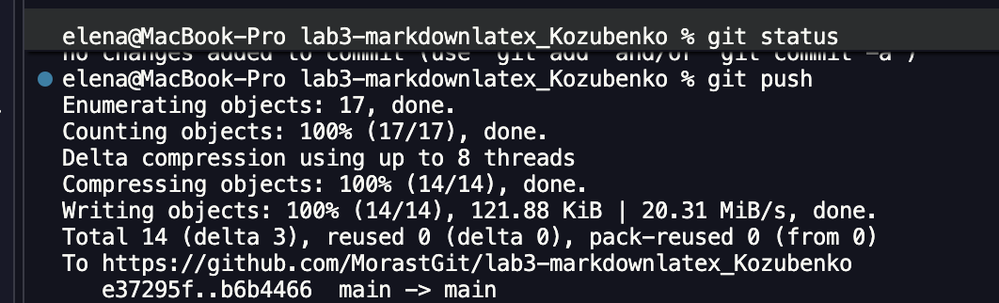

# Лабараторная работа Markdow Latex

Главные цели лабораторной работы это научиться работать с Markdown. В ходе работы были освоены базовые и продвинутые элементы форматирования, включая таблицы, списки, блоки кода, LaTeX-формулы и Alert-блоки GitHub.


## Содержание
- [Структура проекта](#структура-проекта)
- [Форматирование текста](#форматирование-текста)
- [Списки](#списки)
- [Цитата](#цитата)
- [Блок кода](#блок-кода)
- [Таблица](#таблица)
- [Изображение](#изображение)
- [Ссылки](#ссылки)
- [Чекбоксы](#чекбоксы)
- [Сноска](#сноска)
- [Alert-блоки](#alert-блоки)
- [LaTeX-формулы](#latex-формулы)

---

## Структура проекта

- `README.md` — файл с подробным описанием лабораторной
- `img/` — папка с изображениями
- `docs/` — папка с двумя шагами лабораторной 
    - `listlab3_Kozubenko.md` - списки
    - `separatorslab3_Kozubenko` -  описание Markdown
- `advancedMarkdownLab3_Kozubenko/md` - чек-боксы, alert, HTML
- `codeQuotesLab3_Kozubenko.md` - примеры цитат в MarkDown
- `formattingLab3_Kozubenko.md` - примеры форматирования в markdown
- `headersLab3_Kozubenko.md` - информация о Markdown
- `latexlab3_Kozubenko.md` - использование Latex примеры
- `linksImagesLab3_Kozubenko.md` - примеры использования внешних ссылок и вставки изображений
- `practice_3lab.md` - примеры вставки кода, описание задания на C# 

---

## Форматирование текста

В этом разделе продемонстрированы основные способы форматирования:

- **Полужирный текст** — выделяется двумя звёздочками.
- *Курсивный текст* — выделяется одной звёздочкой.
- ~~Зачёркнутый текст~~ — выделяется двумя тильдами.
- `Моноширный текст` — выделяется обратными кавычками.

---

## Списки

### Маркированный список
- Яблоко
- Банан
- Апельсин

### Нумерованный список
1. Первый шаг
2. Второй шаг
3. Третий шаг

### Вложенный список
- Фрукты
  - Яблоко
  - Банан
    - Зелёный
    - Жёлтый
- Овощи
  - Морковь
  - Картофель

---

## Цитата

> «Программы должны быть написаны так, чтобы их могли читать люди, и лишь во вторую очередь — так, чтобы их могли выполнять машины.»
> — Харольд Абельсон

---

## Блок кода

Пример кода на языке Python:

```python
def greet(name):
    return f"Привет, {name}!"

print(greet("Мир"))
```


### Таблица (3 столбца)

| Название | Тип данных | Описание |
| :--- | :--- | :--- |
| `id` | Integer | Уникальный идентификатор пользователя |
| `name` | String | Имя пользователя |
| `email` | String | Электронная почта |

### Изображение



### Ссылки

*   **Внешняя ссылка:** [Официальный сайт GitHub](https://github.com)
*   **Внутренняя ссылка:** [Перейти к таблице](#таблица-3-столбца)

### Чекбоксы

- [x] Task 1: Изучить синтаксис Markdown
- [ ] Task 2: Оформить README-файл

### Сноска

Markdown — это облегчённый язык разметки[^1].

[^1]: Примечание: сноски помогают добавлять комментарии, не загромождая основной текст.

### Alert-блоки GitHub

> [!NOTE]
> Это блок заметки. Полезно для дополнительной информации.

> [!TIP]
> Это блок совета. Помогает сделать что-то быстрее или лучше.

> [!WARNING]
> Это блок предупреждения. Обратите внимание на важные детали.

### Inline LaTeX

Площадь круга вычисляется по формуле: $S = \pi r^2$.

### Block LaTeX

Формула суммы первых $n$ натуральных чисел:

$$
\sum_{i=1}^n i = \frac{n(n+1)}{2}
$$